  

  
  
  

 

 🔭 Majoring in <b>Computer Science and Technology</b> at <b>Tsinghua University</b>.  
 🌱 Currently working on <b>LLM</b> and <b>BCI</b>.

 

  <picture>
    <source media="(prefers-color-scheme: dark)" srcset="https://skillicons.dev/icons?i=py%2Ccpp%2Cjava%2Cvue%2Creact%2Clinux%2Cgit%2Cvim%2Cpytorch%2Cdocker%2Clatex&perline=11&theme=dark" />
    
  </picture>

 

  <picture>
    <source media="(prefers-color-scheme: dark)" srcset="./profile/stats-dark.svg" />
    
  </picture>
  <picture>
    <source media="(prefers-color-scheme: dark)" srcset="./profile/langs-dark.svg" />
    
  </picture>

 

  <picture>
    <source media="(prefers-color-scheme: dark)" srcset="https://raw.githubusercontent.com/Daucloud/Daucloud/output/fireworks-dark.svg" />
    
  </picture>

